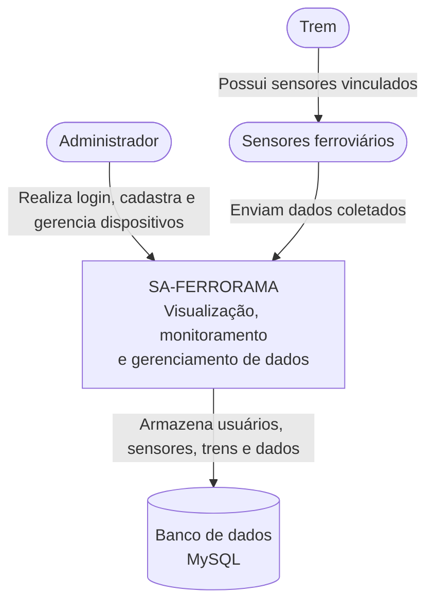

# SA-FERRORAMA

## Resumo

O SA-FERRORAMA é um sistema desenvolvido para a visualização, o monitoramento e o gerenciamento de dados provenientes de sensores instalados em um Ferrorama. Esses sensores coletam informações relacionadas aos trens que circulam na maquete ferroviária. Os dados são enviados ao sistema, onde podem ser organizados e apresentados ao usuário de forma clara e intuitiva.

---

## Proposta

A principal proposta do projeto é centralizar as informações coletadas pelos sensores em uma única plataforma, facilitando o acompanhamento dos dados e permitindo uma melhor administração dos dispositivos ferroviários.

Por meio da interface do sistema, o usuário poderá visualizar informações coletadas, acompanhar o comportamento dos sensores e utilizar gráficos e indicadores para interpretar os dados de maneira mais rápida e eficiente.

Para o desenvolvimento da aplicação, serão utilizadas tecnologias como PHP, HTML, CSS e JavaScript, com o XAMPP como ambiente de desenvolvimento local. O Bootstrap auxiliará na construção de uma interface moderna, organizada e responsiva. O Chart.js será utilizado para representar visualmente os dados dos sensores, facilitando a análise das informações.

O projeto também busca seguir boas práticas de desenvolvimento de software, priorizando a organização dos arquivos, a separação de responsabilidades, a validação dos dados e a segurança nas operações com o banco de dados.

Além disso, o desenvolvimento utiliza práticas de Scrum e Kanban para organizar as atividades, acompanhar o andamento do projeto, definir prioridades e facilitar a divisão das tarefas entre os integrantes da equipe.

---

## Funcionalidades

- Login e autenticação de usuários.
- Cadastro de usuários.
- Cadastro, consulta e edição de sensores.
- Cadastro, consulta e edição de trens.
- Associação entre trens e sensores.
- Visualização e gerenciamento dos dados recebidos.
- Monitoramento dos dados dos sensores.
- Representação dos dados por meio de gráficos e indicadores.
- Acompanhamento das informações ferroviárias.

---

## Pré-requisitos

- XAMPP.
- PHP.
- MySQL ou MariaDB.
- Navegador web.
- Git, caso o projeto seja clonado pelo terminal.

---

## Instalação e Execução

### 1. Clonar pasta

Clone o repositório dentro da pasta _htdocs_ do XAMPP.

### 2. Iniciar Apache e MySQL

Abra o painel de controle do XAMPP e inicie os serviços Apache e MySQL.

### 3. Configurar o banco de dados

1. Acesse o phpMyAdmin no navegador.
2. Importe o arquivo _infra/database/script.sql_.
3. Verifique se o banco de dados foi criado corretamente.
4. Configure as credenciais e portas segundo o arquivo _infra/database/conn.php_.

---

## Requisitos do Sistema

### Principais requisitos funcionais

- **RF01:** Autenticação de usuários por e-mail e senha.
- **RF02:** Cadastro e gerenciamento de trens e sensores.
- **RF03:** Visualização de informações dos sensores, como velocidade, localização e status operacional.
- **RF04:** Proteção contra a exclusão de sensores com dados associados.
- **RF05:** Visualização de gráficos de desempenho e tendências.
- **RF06:** Recebimento e registro de dados dos sensores IoT.
- **RF07:** Disponibilização de uma seção de Suporte.

### Principais requisitos não funcionais

- **RNF01:** Tempo de resposta da tela de login de até 3 segundos em condições normais.
- **RNF02:** Segurança na autenticação e no controle de acesso.
- **RNF03:** Interface responsiva para diferentes dispositivos.
- **RNF04:** Proteção das operações realizadas no banco de dados.

Documeto contendo todos os requisitos do sistema: [`docs/requisitos_de_sistema_da_sa.md`](docs/requisitos_de_sistema_da_sa.md).


## Estrutura do Projeto

```text
├── assets/
│   ├── fonts/
│   └── images/
│
├── docs/
│   ├── pesquisa sobre APIs.md
│   ├── pesquisa Sobre PDO.md
│   ├── pesquisa Sobre PHP e CRUD.mdd
│   ├── pesquisa sobre SCRUM.md
│   ├── pesquisa sobre XAMPP.md
│   └── requisitos do sistema.md
│
├── infra/
│   └── database/
│       ├── conn.php
│       └── script.sql
│
├── java/
│   └── script.js
│
├── public/
│   ├── component/
│   ├── services/
│   ├── erro.php
│   ├── home.php
│   ├── logout.php
│   ├── monitoramento.php
│   ├── rotas.php
│   ├── sensores.php
│   ├── suporte.php
│   ├── trens.php
│   └── usuarios.php
│
├── styles/
│   └── style.css
│
├── index.html
├── LICENSE
└── README.md
```

---

## Tecnologias Utilizadas

<p align="center">
  
  
  
  
  
  
  
  
  
</p>

---

## Diagrama de Contexto



---

## Conclusão

O SA-FERRORAMA tem como objetivo integrar a coleta de dados dos sensores ferroviários a uma plataforma de monitoramento acessível e organizada. Dessa forma, as informações captadas pelo Ferrorama podem ser transformadas em dados úteis para o acompanhamento, a análise e o gerenciamento dos equipamentos.

O projeto busca aplicar conhecimentos de desenvolvimento web, integração com banco de dados, organização de software e metodologias ágeis na construção de uma solução voltada ao monitoramento ferroviário.

---

## Licença

Este projeto está sob a licença MIT.

Consulte o arquivo `LICENSE` para obter mais informações sobre os termos de utilização, modificação e distribuição do software.
